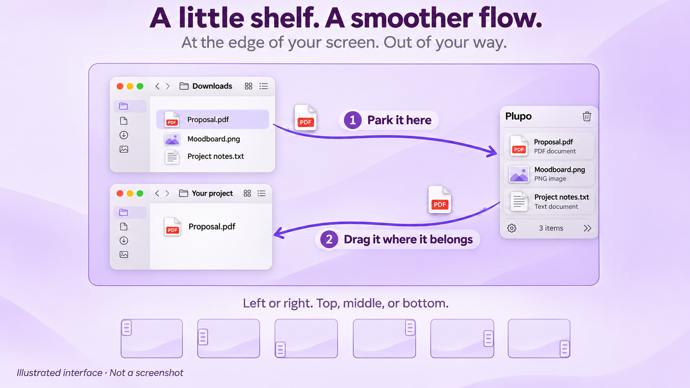

# Plupo — A Free, Open-Source Yoink Alternative for macOS

*Drag. Drop. Keep moving.*

Plupo is a free, open-source macOS drag-and-drop shelf for Apple Silicon and Intel. It gives files a temporary home while you work: drag items into the shelf, switch between apps, and drop them wherever you need them.

No complicated workflows. Just drag, drop, and keep moving.

[**Download for Mac ↓**](https://github.com/planetic-labs/plupo/releases/latest/download/Plupo-universal.dmg) · [Release notes](https://github.com/planetic-labs/plupo/releases/latest) · [Website](https://planetic-labs.github.io/plupo/)

Apple Silicon & Intel · macOS 14.0 or later · Free and open source

<p align="center">
  
  <br>
  <sub>Illustrated workflow, not a screenshot. Park a file, switch windows, and drag it where it belongs.</sub>
</p>

## Overview

Keep a few files close at hand while finding a destination in another window or application. Plupo lives in the menu bar and provides a small floating shelf at the edge of your screen.

The shelf is temporary, not a backup or file manager. File items reference their original locations, and the shelf is not restored after quitting.

## Features

The current source implements:

- Automatic shelf appearance when a drag starts, with hiding when the shelf is empty.
- File drops, including multiple items. Links, plain text, and image data are also handled when the source app supplies a supported representation.
- Native dragging from the shelf to other applications.
- Left or right positioning, with top, center, or bottom alignment.
- Individual removal, item locking, and clearing all unlocked items.
- A preference to keep items after dragging them out, plus three item sizes.
- A menu bar command to show or hide the shelf and open preferences.

Compatibility depends on the representations supplied by the source app and accepted by the destination. Interactive testing across applications and displays is still needed.

## Requirements

- **macOS 14.0 or later**, as configured in the Xcode project.
- **Apple Silicon or Intel Mac**. The universal app includes both architectures.

One universal DMG runs natively on Apple Silicon (`arm64`) and Intel (`x86_64`). Intel and macOS 14 runtime behavior still needs testing on those systems.

The app uses macOS drag-and-drop integration and sandboxed, read-only access to user-selected files. There is no explicit Accessibility or Input Monitoring permission request in the current source; cross-application drag detection has not been verified interactively.

## Installation

[**Download Plupo for Apple Silicon and Intel**](https://github.com/planetic-labs/plupo/releases/latest)

1. Download `Plupo-universal.dmg` from the latest release.
2. Open the DMG and drag **Plupo** into **Applications**.
3. Eject the DMG and open Plupo from Applications.

These early preview builds use an ad-hoc signature, without an Apple Developer ID certificate or Apple notarization. macOS may block the first launch. If you trust the download, try opening Plupo once, then choose **System Settings → Privacy & Security → Open Anyway** and confirm. See [Apple's first-launch guidance](https://support.apple.com/102445). Do not disable system-wide security protections.

Release downloads include a SHA-256 checksum. The app is built on GitHub for Apple Silicon and Intel without an Apple account or personal signing certificate. You can also build from source below.

## Updates

Use **Check for Updates…** in the menu bar or Preferences to find a newer release. Automatic checks are enabled by default and can be disabled in Preferences. A new version opens a release page only when you choose **View Release**; download its DMG and replace Plupo in Applications manually. Older versions without this feature need to be updated manually once.

## Build from Source

You need a Mac and Xcode with its macOS SDK and command-line tools selected. The project records Xcode 26.3 as its creation version and uses Swift 5 language mode. Compatibility with older Xcode versions has not been verified. There are no third-party package dependencies; the interface uses SwiftUI and AppKit.

1. Clone this repository:

   ```sh
   git clone https://github.com/planetic-labs/open-drag-shelf.git
   cd open-drag-shelf
   ```

2. Open `Plupo.xcodeproj` in Xcode.
3. Select the **Plupo** scheme and your Mac as the run destination.
4. Choose **Product → Run**. If signing is required, select your development team in **Signing & Capabilities**. For a personal signed build, use your own unique bundle identifier.

To attempt a local Debug build without signing:

```sh
xcodebuild -project Plupo.xcodeproj -scheme Plupo \
  -configuration Debug -destination 'generic/platform=macOS' \
  -derivedDataPath build ARCHS="arm64 x86_64" ONLY_ACTIVE_ARCH=NO CODE_SIGNING_ALLOWED=NO build
```

The expected output is `build/Build/Products/Debug/Plupo.app`.

Universal Release builds target both Apple Silicon and Intel with a minimum of macOS 14.0. Compilation does not replace runtime testing on Intel or macOS 14.

## Usage

1. Launch Plupo, then start dragging a file from Finder.
2. Drop it onto the shelf. Use **Toggle Shelf** in the menu bar if needed.
3. Switch to the destination application or folder.
4. Drag the item from Plupo to its destination.

Use the item's lock button or enable **Keep items on shelf after dragging them out** in preferences when you need to reuse an item. The trash button clears unlocked items; an item's remove button removes it individually.

## Why Plupo?

Plupo aims to be a small, thoughtfully crafted native Mac utility: simple interactions, minimal interruptions, and a focused native Mac experience. It is free and open source under the MIT license.

Plupo is independently developed as an alternative to utilities such as Yoink and Dropover. It is not affiliated with, sponsored by, or endorsed by their developers.

## Project Status

Plupo is in early development. Features and behavior may change. It has not been validated for everyday use.

Current behavior and limitations:

- Items are removed only after a destination accepts the drag. Cancelled or rejected drags keep the item; locked items and the keep-items preference preserve it.
- Quick Look previews files, text, and images in a dedicated window. A link preview opens the browser only when you click **Open Link**.
- Launch at login uses macOS Service Management. Registration and first-launch approval still need manual verification with an installed build, particularly for the ad-hoc-signed downloads.
- **Manual (Menu Bar)** mode uses the menu bar to toggle the shelf; no system-wide keyboard shortcut is registered.
- File size and thumbnail metadata are captured when an item is added and are not continuously refreshed.

The current code passes 26 import, drag, and export regression checks plus 9 window and menu checks. These do not replace interactive testing across applications.

## Privacy

Plupo checks GitHub for new releases automatically, at most once a day while running, and when you choose **Check for Updates…**. You can disable automatic checks in Preferences. Requests go to GitHub and include standard connection information such as your IP address; shelf contents and local file paths are never included. There is no analytics code. Shelf contents are held in memory, and preferences are stored locally in UserDefaults. Dragging text or images out creates temporary export files with restricted permissions; these are removed on normal exit or the next launch. A crash can leave them on disk until that next launch. Opening a link or file hands it to its associated application.

Changing the bundle identifier does not migrate preferences from the previous identifier.

## Contributing

Bug reports, feature suggestions, pull requests, and general feedback are welcome. [Open an issue](https://github.com/planetic-labs/open-drag-shelf/issues) with your macOS version, steps to reproduce, and the source and destination apps involved. Please discuss larger changes before starting a pull request.

## License

Plupo is released under the [MIT License](LICENSE).
